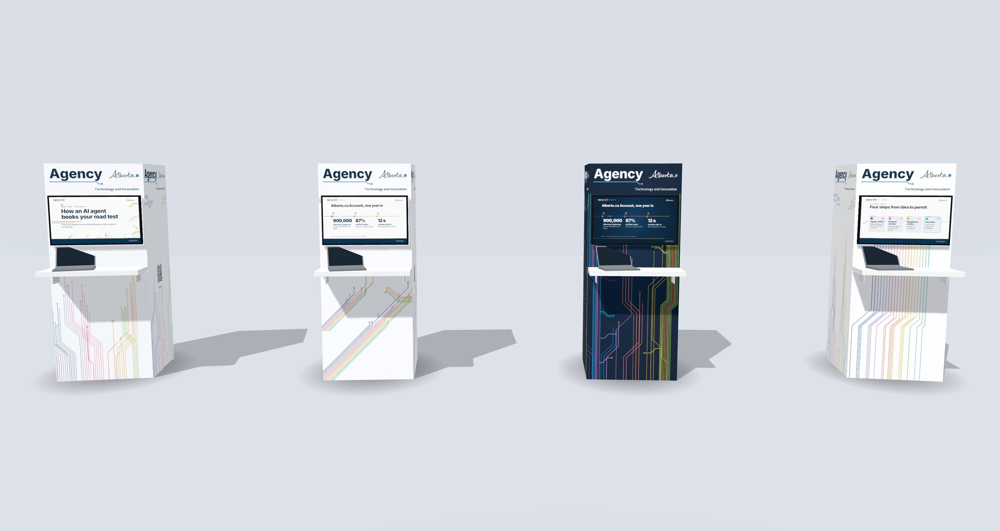

# Displays: stand panels and demo kiosks

Parametric print graphics for the Agency 2026 floor: single **stand panels** (about 2 to 2.5 ft wide, 5 to 7 ft tall) and **demo kiosks**
(a 2.5 × 2.5 ft column with a monitor on the front and a small desk ledge, wrapped on all four sides). You give a size; the scripts draw the
art in real inches and write the files a large-format printer needs.

Every face carries the same header lockup: **"Agency"** across the top (no date), the **Alberta logo** top right, and **"Technology and
Innovation"** beneath it, with the circuit-trace art of the event below. Six designs share that lockup.



## Quick start

```bash
node displays/build.mjs displays/specs/kiosk-30x30x72.json                 # the spec's own design
node displays/build.mjs displays/specs/kiosk-30x30x72.json --variant all   # all six designs
node displays/build.mjs displays/specs/panel-30x72.json --set width=24,height=66   # change a size without editing the spec
node displays/layout.mjs displays/specs/*.json                             # dimensioned layout drawings
node displays/render.mjs                                                   # photo-style mock-ups -> examples/displays/renders/
```

Outputs land in `out/displays/<spec>/<design>/` (not in git; rebuild any time). Finished examples are in `examples/displays/`.

## The designs

| Design | What it does | Best for |
|---|---|---|
| `rise` | Bus traces rise from the floor, a little heavier near the floor, fading as they climb | the default; reads well from across a hall |
| `rails` | Traces run down both long edges and branch inward; the centre stays clean | panels with a title or QR code |
| `wrap` | Bands of traces run unbroken round all four faces of a kiosk, with drops to the floor | kiosks seen from every side |
| `spectrum` | Thin diagonal buses in spectrum order (purple to cyan), each trace ending in its own pad | a single statement panel |
| `night` | Night-navy ground, rails and rising traces with a soft glow, white type | contrast in a row of white stands |
| `converge` | Buses climb from the floor and turn at 45° toward the monitor (a kiosk) or the QR code, title or a quiet centre (a panel); a kiosk's other faces use `rise` | the front of a demo station |

Every design uses **thin traces only**, like a real circuit board: no stroke is wider than 0.2 in at full size, and pads are in
proportion. There are no ribbons and no chip icon (owner direction, 2026-11-11).

Same seed, same art. Change `seed` in the spec for a fresh arrangement in the same design.

| Galleries | |
|---|---|
| `examples/displays/galleries/kiosk-30x30x72-variants.jpg` | every design, all four faces of the 72 in kiosk |
| `examples/displays/galleries/kiosk-30x30x84-variants.jpg` | the same for the 84 in kiosk |
| `examples/displays/galleries/*-wrap.jpg` | the unrolled kiosk wrap (front, right, back, left), showing the art running round the corners |
| `examples/displays/galleries/panel-*-variants.jpg` | every design on each panel size |
| `examples/displays/renders/*.jpg` | mock-ups: a kiosk hero shot, spectrum and night kiosks, the wrap from behind, a row of four, and panel stands |

## Parameters (a spec file)

| Field | Default | Meaning |
|---|---|---|
| `kind` | `panel` | `panel` (one flat face) or `kiosk` (four faces: front, right, back, left) |
| `unit` | `in` | `in`, `ft`, `cm` or `mm` for every size in the spec |
| `width`, `height`, `depth` | 30, 72, 30 | panel or kiosk size; `depth` is the kiosk's side faces |
| `preset` | none | `panel-24x60`, `panel-30x72`, `panel-30x84`, `kiosk-30x30x72`, `kiosk-30x30x84` |
| `variant` | `rise` | `rise`, `rails`, `wrap`, `spectrum`, `night` or `converge` |
| `ground` | `board` | `board` (white), `night` or `navy`; `night` design forces a dark ground |
| `seed` | from the size | any text; the same seed gives the same art |
| `wordmark` | `Agency` | `Agency` or `Agency 2026`. Never a date |
| `font` | `inter` | `inter` (the MVAI kit's type) or `liberation` (Arial metrics, the event team's compliant set). Owner decision pending: guides/BRAND.md, "Two palettes" |
| `bleed` | 0.125 | in the spec's unit; many large-format vendors ask for 0.5 to 1 in, so set it to their spec |
| `margin` | 1.5 | safe margin: type, the logo and QR codes stay inside it |
| `subCapHeight` | 0.75 | cap height of "Technology and Innovation" (0.75 in reads at about 7.5 ft; see the table in guides/DISPLAYS.md) |
| `agencyWidth`, `logoWidth` | auto | share of the content width for "Agency" and for the logo, if you need to rebalance |
| `monitor` | kiosk front | `{ w, h, bottom, centerX, clear }`: the screen window, 16:9 unless `h` is given. Default 37.5 in wide (a 43 in screen) fitted to the face inside the margins (27 in on a 30 in face, about a 31 in screen), bottom 46 in from the floor. `false` removes it; a panel can ask for one |
| `ledge` | kiosk front | `{ height: 38, depth: 12, thickness: 1.5 }`. The art runs behind it; it shows in drawings and renders only |
| `title` | none | `{ kicker, text, face, size }`: a session or demo title under the header |
| `qr` | none | `{ url, label, face, size, bottom }`: a QR code (label is outlined under it) |
| `faces` | all on | `{ back: { lockup: false } }` turns the lockup off on one face |

`displays/display.schema.json` is the JSON Schema; `out/displays/<spec>/<design>/spec.resolved.json` shows every value in inches after defaults.

## Files, and which one goes to the printer

| File | What it is | Send it? |
|---|---|---|
| `<face>-production.pdf` | CMYK art at trim + bleed, crop marks, and a **CutContour** spot-colour path on the trim and the monitor window; TrimBox and BleedBox set | **yes**: this is the print file |
| `wrap-production.pdf` (kiosks) | the four faces as one artboard, with **Fold** ticks outside the trim | yes, if the vendor prints one wrap |
| `<face>-cmyk.pdf` | CMYK art at trim + bleed, no marks | if the vendor adds their own marks |
| `<face>.pdf` / `<face>.ai` | vector RGB PDF at trim + bleed; the `.ai` is the same PDF-compatible file, which Illustrator opens as editable vectors | for a designer to adjust |
| `<face>.svg` | real-size vector (inches), layers Ground / Art / Brand / Content / CutContour | for any vector tool |
| `<face>.png` | preview at 40 ppi, with a mock screen in the monitor window | for review only |

Ask the vendor for their ICC profile and rebuild with `--icc vendor.icc`: the generic profile puts the night designs near 360% total ink,
above the 300% most large-format printers accept. Always get a printed proof of the navy and the spectrum before the full run
(guides/PRINT-PRODUCTION.md has the measured colour shifts).

## How the vectors are made

1. **Model** (`lib/model.mjs`): the spec becomes faces in inches. Each face gets its header lockup geometry and its **clear zones**:
   the header, the monitor window (plus 0.75 in), the title and the QR code.
2. **Lockup**: "Agency", "Technology and Innovation" and any title are **outlined** with fontTools (`lib/outline.py`), so production files
   carry no live text and print the same everywhere. The Alberta logo is the official vector (`brand/logos/alberta-logo.svg`).
3. **Traces** (`lib/traces.mjs`, `lib/designs.mjs`): seeded buses of parallel traces run in from the edges with 45° bends and ring pads,
   at print scale (0.09 to 0.17 in lines; `draw()` caps every stroke at 0.2 in). Every trace is clipped where it would enter a clear zone; the cut end gets a pad,
   so traces look routed round the screen and the type, not hidden behind them.
4. **Wrap**: the kiosk's four faces are laid side by side as one strip (front, right, back, left) and the `wrap` design is drawn once on
   it, then sliced into faces, so every trace meets itself at the corners.
5. **Output** (`build.mjs`): SVG at real size, then Chromium writes a vector PDF at trim + bleed, Ghostscript converts it to CMYK, and
   `lib/production.py` adds crop marks and the CutContour / Fold spot colours on a larger sheet.
6. **Layout drawings** (`layout.mjs`) and **renders** (`render.mjs`, three.js) read the same model and the same SVG, so a size change shows
   up in the art, the drawing and the mock-up together.

## Limits

- The `.ai` files are PDF-compatible Illustrator files, not native ones: Illustrator opens them as editable vector groups, without
  Illustrator's own layer names. The SVGs keep the layer names.
- CutContour is a spot colour on a path, not a PDF layer (OCG). Most contour cutters and RIPs read the spot name; rename it with
  `--cut-name` in `lib/production.py` if the vendor uses a different one (for example `Through-cut` or `Dieline`).
- The monitor window is a no-art mount zone. Whether it is cut out, or the screen hangs in front of printed board, is a build decision for
  the vendor: the CutContour path marks it either way.
- Renders are mock-ups for planning, not colour proofs.
